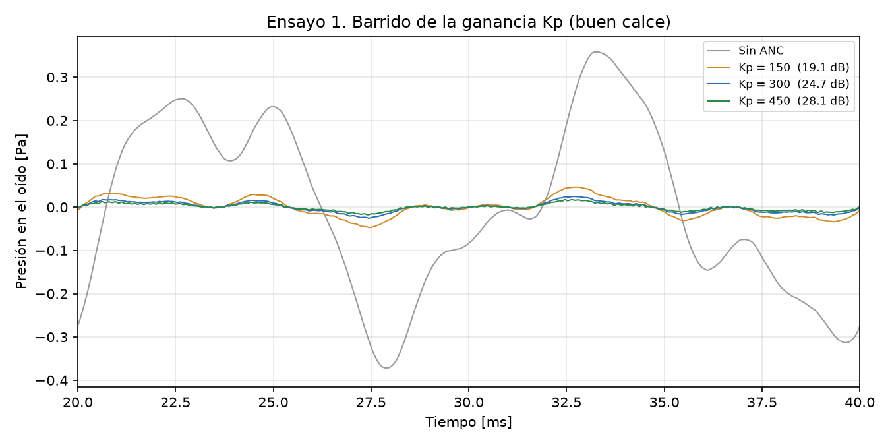

# Caso 01: barrido de la ganancia Kp

*Es la figura 4 del informe (sección 9.2).*

## 1. Qué se prueba y por qué

Se prueba que **la atenuación crece con la ganancia del controlador**. Es la idea central del
control proporcional: cuanto más grande es Kp, más grande es la ganancia de lazo KL y más
chico el error que queda. También se prueba que la atenuación real, con un ruido que tiene
componentes de hasta 500 Hz, queda **por debajo** del valor estático, porque la ganancia de
lazo cae al subir la frecuencia.

## 2. Parámetros usados

- Kp = 150, 300 y 450 V/V.
- Buen calce: K = 1, τ = 1 ms. Retardo T = 40 µs. Ka = 6 Pa/V, Km = 0,0126 V/Pa, Umáx = 3 V.
- Ruido ambiente nominal (tonos de 100, 250 y 500 Hz más ruido aleatorio), sin prealimentación.
- 40 ms simulados; la atenuación se mide descartando los primeros 10 ms (transitorio).
- Banda baja: tono de 50 Hz sin ruido ambiente, medido entre 100 y 200 ms.

## 3. Qué predice el informe

- **Sección 8.3:** la atenuación en estado estable es 20·log(1 + KL), con KL = Kp·Ka·K·Km.
  Crece con Kp. Al subir en frecuencia la ganancia de lazo cae y la atenuación disminuye.
- **Sección 6.7:** es falla si la atenuación en la banda baja queda por debajo de 20 dB.
- **Sección 9.2** reporta 19,1, 24,7 y 28,1 dB para Kp = 150, 300 y 450.

## 4. Qué dio la simulación

| Kp | Atenuación estática (8.3) | Atenuación medida (ruido completo) | Banda baja (50 Hz) | Veredicto | ¿Coincide con la predicción? |
|---|---|---|---|---|---|
| Kp = 150 | 21,8 dB | 19,1 dB | 21,4 dB | Error admisible | Sí |
| Kp = 300 | 27,5 dB | 24,7 dB | 27,1 dB | Error admisible | Sí |
| Kp = 450 | 30,9 dB | 28,1 dB | 30,5 dB | Error admisible | Sí |

La atenuación crece con Kp y en los tres casos queda por debajo del valor estático, como
predice la sección 8.3. Los valores medidos coinciden con los de la sección 9.2.

## 5. Veredicto

Los tres valores son **error admisible** en este ensayo (buen calce): el lazo es estable y la
banda baja supera los 20 dB. Sobre el ruido completo, Kp = 150 da 19,1 dB, apenas por debajo
de la meta, pero el criterio de la sección 6.7 se aplica a la banda baja.

> **Kp = 150 está por debajo de la ventana de diseño de la sección 8.6 (198 ≤ Kp < 447).** Con buen calce cumple (unos 21,4 dB en la banda baja), pero con mal calce daría unos 17,7 dB, que es falla. Por eso no es un valor de diseño válido aunque en este ensayo cumpla.

> **Kp = 450 está por encima de la ventana de diseño de la sección 8.6 (198 ≤ Kp < 447).** Con buen calce es estable y atenúa 30,5 dB en la banda baja, pero con mal calce supera el Kp máximo exacto (447) y el lazo oscila (con un tono de 50 Hz queda 10,0 dB *por encima* del valor sin ANC). Tampoco es un valor de diseño válido aunque en este ensayo cumpla.
