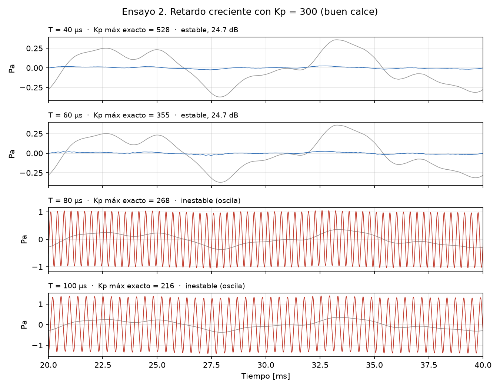

# Caso 02: retardo creciente

*Es la figura 5 del informe (sección 9.3).*

## 1. Qué se prueba y por qué

Se prueba que **el retardo es lo que vuelve condicional la estabilidad**. Sin retardo, el lazo
sería estable con cualquier Kp; con retardo, existe un Kp máximo, y ese máximo baja cuando el
retardo crece. Con Kp fijo, alcanza con aumentar el retardo para que el lazo oscile. Es la
razón por la que el control no puede depender de una red (sección 10.2).

## 2. Parámetros usados

- Kp = 300 V/V, buen calce (K = 1, τ = 1 ms), Umáx = 3 V, ruido ambiente nominal.
- Retardo T = 40, 60, 80 y 100 µs.
- 40 ms simulados. Atenuación medida desde los 10 ms; oscilación y saturación medidas en los
  últimos 10 ms.
- "Oscila" se decide **mirando la señal**: con ANC queda más presión que sin ANC.

## 3. Qué predice el informe

- **Sección 8.4:** sin retardo el lazo es estable para cualquier Kp; el retardo impone un Kp
  máximo.
- **Sección 9.3:** el Kp máximo exacto cae a 528, 355, 268 y 216. Con 40 y 60 µs el lazo es
  estable y atenúa 24,7 dB; con 80 y 100 µs, Kp = 300 supera el límite y el lazo oscila.

## 4. Qué dio la simulación

| Retardo | Kp máx exacto | Predicción (Kp = 300) | Señal simulada | Atenuación | Tiempo saturado | Veredicto | ¿Coincide con la predicción? |
|---|---|---|---|---|---|---|---|
| 40 µs | 528 | estable | no oscila | 24,7 dB | 0 % | Error admisible | Sí |
| 60 µs | 355 | estable | no oscila | 24,7 dB | 0 % | Error admisible | Sí |
| 80 µs | 268 | inestable | oscila | amplifica (-11,1 dB) | 41 % | Falla (oscila y satura) | Sí |
| 100 µs | 216 | inestable | oscila | amplifica (-13,3 dB) | 54 % | Falla (oscila y satura) | Sí |

La señal confirma la predicción analítica en los cuatro casos: con 80 y 100 µs la presión con
ANC supera a la presión sin ANC y el parlante pasa buena parte del tiempo saturado en ±3 V.

## 5. Veredicto

- **T = 40 y 60 µs: error admisible.** Estable y con más de 20 dB en la banda baja.
- **T = 80 y 100 µs: falla (oscila y satura).** Es la falla que el ensayo busca provocar, y
  ocurre exactamente donde la predice el informe.
