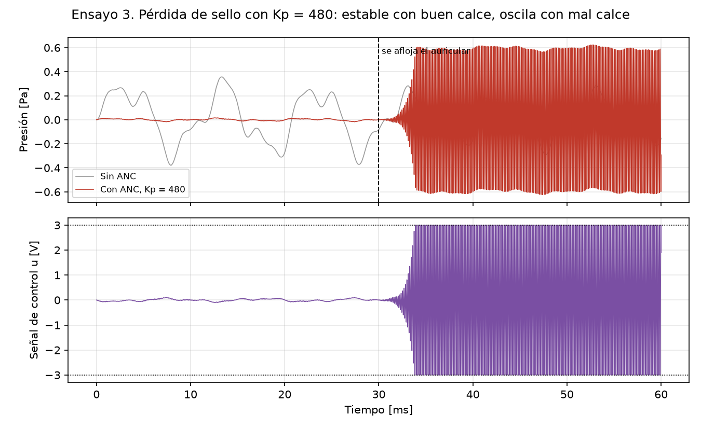

# Caso 03: pérdida de sello

*Es la figura 6 del informe (sección 9.4).*

## 1. Qué se prueba y por qué

Se prueba que **la ventana de sintonía tiene que evaluarse con el peor calce**. Un Kp que
funciona bien con el auricular bien puesto puede hacer oscilar el lazo cuando el auricular se
afloja, porque el mal calce baja el Kp máximo. Es el silbido de un auricular mal calzado, y es
el caso en que la aproximación de Padé daría el lazo por estable cuando no lo es.

## 2. Parámetros usados

- Kp = 480 V/V, T = 40 µs, Umáx = 3 V, ruido ambiente nominal.
- De 0 a 30 ms, buen calce (K = 1, τ = 1 ms). A los 30 ms el auricular se afloja: mal calce
  (K = 0,6, τ = 0,5 ms) hasta los 60 ms.
- Atenuación antes de aflojarse medida entre 10 y 30 ms. Oscilación, saturación y frecuencia
  medidas en los últimos 20 ms.

## 3. Qué predice el informe

- **Sección 8.6:** el caso Kp = 480 muestra por qué la ventana se evalúa con el peor calce:
  Padé lo daría por estable (Kp máx Padé 573), pero con mal calce supera el
  límite exacto de 447 y el lazo oscila a unos 6,4 kHz. Con buen calce el límite exacto es
  528 (Tabla 9), así que antes de aflojarse el lazo es estable.
- **Sección 6.7:** la oscilación y la saturación sostenida son falla; la pérdida de sello es
  perturbación si es momentánea y falla si persiste.
- **Sección 9.4** reporta 28,6 dB con buen calce y, al aflojarse, oscilación con la salida
  saturada en ±3 V.

## 4. Qué dio la simulación

| Tramo | Kp máx exacto | Resultado | Veredicto | ¿Coincide con la predicción? |
|---|---|---|---|---|
| Buen calce (0 a 30 ms) | 528 | Estable; 28,6 dB sobre el ruido completo (31,4 dB estático), 31,0 dB en la banda baja | Error admisible | Sí |
| Mal calce (30 a 60 ms) | 447 | Oscila a 6,35 kHz; parlante saturado el 37 % del tiempo | Falla (oscila y satura) | Sí |

## 5. Veredicto

- **Antes de aflojarse: error admisible.**
- **Después de aflojarse: falla (oscila y satura).** Como la pérdida de sello persiste hasta el
  final del ensayo, por la sección 6.7 es falla y no perturbación. Es la falla que el ensayo
  busca provocar, y ocurre como la predice el informe.
