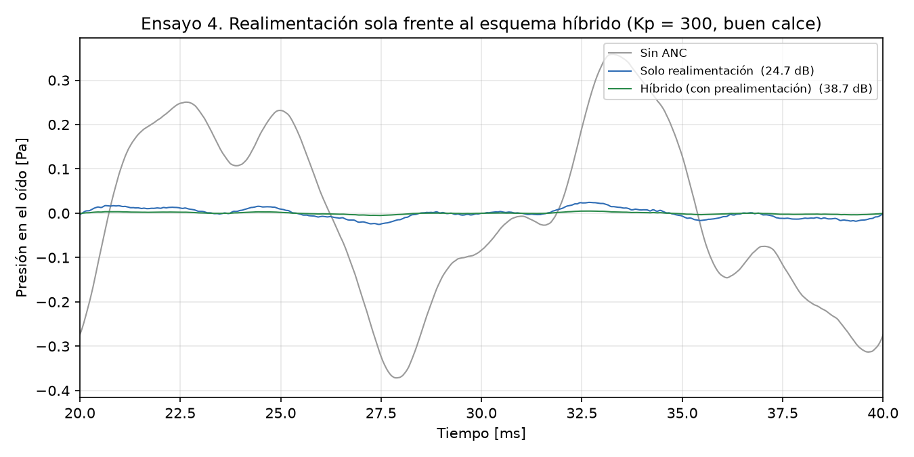

# Caso 04: realimentación sola y esquema híbrido

*Es la figura 7 del informe (sección 9.5).*

## 1. Qué se prueba y por qué

Se prueba cuánto agrega la **prealimentación**: un micrófono externo escucha el ruido antes de
que entre y el parlante lo anticipa, sin esperar a que aparezca un error. La realimentación
sola siempre llega tarde y deja un error de tipo 0; la prealimentación cancela de antemano una
parte del ruido y la realimentación solo tiene que ocuparse del resto.

## 2. Parámetros usados

- Kp = 300 V/V, buen calce (K = 1, τ = 1 ms), T = 40 µs, Umáx = 3 V, ruido ambiente nominal.
- Prealimentación apagada y encendida con un ajuste del 80 %.
- 40 ms simulados; atenuación medida desde los 10 ms.

## 3. Qué predice el informe

- **Sección 9.5:** la prealimentación con un ajuste del 80 % mejora la atenuación en
  20·log(1/(1 − 0,8)) = 13,98 dB, porque en el simulador es ideal (usa la misma
  perturbación que llega al oído y el mismo retardo que el anti-ruido). Reporta 24,7 dB sin
  prealimentación y 38,7 dB con ella.

## 4. Qué dio la simulación

| Esquema | Atenuación (ruido completo) | Banda baja (50 Hz) | Veredicto |
|---|---|---|---|
| Solo realimentación | 24,7 dB | 27,1 dB | Error admisible |
| Híbrido (con prealimentación) | 38,7 dB | 41,1 dB | Error admisible |

Mejora medida: **13,98 dB**, frente a 13,98 dB predichos.
¿Coincide con la predicción? **Sí**.

## 5. Veredicto

**Error admisible en los dos esquemas.** Aclaración: la mejora de 14 dB vale para la
prealimentación ideal del simulador. En un auricular real el micrófono externo escucha el
ruido por otro camino acústico y la mejora sería menor (ver README del repositorio,
"Simplificaciones del modelo").
