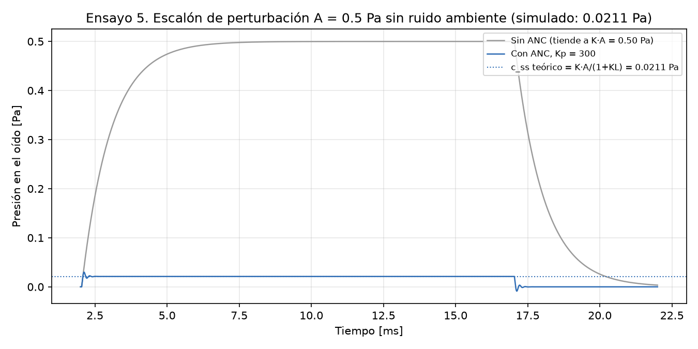

# Caso 05: error en estado estable ante un escalón

*Es la figura 8 del informe (sección 9.6).*

## 1. Qué se prueba y por qué

Se prueba la fórmula del **error en estado estable** de la sección 8.3, obtenida con el
teorema del valor final. El lazo es de tipo 0 (no tiene polos en el origen), así que ante una
perturbación escalón el error no se anula: queda un valor finito, K·A/(1 + KL), que es más
chico cuanto más grande es KL. También se prueba la forma de la respuesta: con el retardo, la
presión pasa su valor final antes de asentarse (sobrepico).

## 2. Parámetros usados

- Kp = 300 V/V, buen calce (K = 1, τ = 1 ms), T = 40 µs, Umáx = 3 V.
- **Sin ruido ambiente**, para que el escalón se vea limpio.
- Escalón de perturbación de A = 0,5 Pa aplicado a los 2 ms, de 15 ms de duración.
- KL = Kp·Ka·K·Km = 22,68.
- Valor final medido como promedio entre 12 y 17 ms. Asentamiento: último instante fuera de
  la banda de ±2 % del valor final.

## 3. Qué predice el informe

- **Sección 8.3:** sin ANC la presión tiende a K·A = 0,5 Pa; con ANC, a
  K·A/(1 + KL) = **0,0211 Pa**. No se anula porque el sistema es de tipo 0.
- **Sección 8.6:** con Kp = 300 y buen calce, la presión residual sobrepasa su valor final
  en un 41,5 % y se asienta dentro del 2 % en unos 0,43 ms (ensayo 5).
- **Sección 9.6** reporta 0,0211 Pa.

## 4. Qué dio la simulación

| Magnitud | Predicción | Simulación |
|---|---|---|
| Valor final sin ANC | 0,5000 Pa | 0,5000 Pa |
| Valor final con ANC (c_ss) | 0,0211 Pa | 0,0211 Pa |
| Residuo respecto de sin ANC | 4,2 % | 4,2 % |
| Sobrepico | 41,5 % (8.6) | 41,5 % |
| Tiempo de asentamiento (2 %) | 0,43 ms (8.6) | 0,434 ms |

¿Coincide con la predicción? **Sí**.

## 5. Veredicto

**Error admisible.** Queda el 4,2 % del escalón, dentro de la banda de error que admite
la meta de 20 dB (como máximo la décima parte, sección 6.7). Que el error no sea cero no es una
falla: es el error en estado estable propio de un sistema de tipo 0 con acción proporcional.
