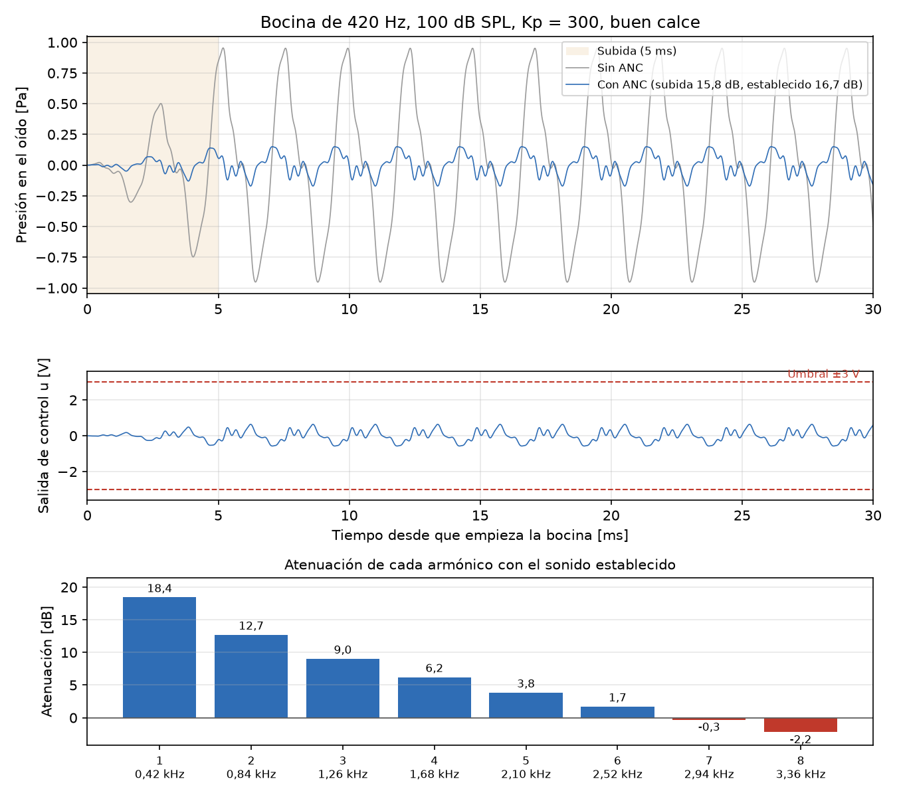

# Caso 06: ruido de golpe (bocina)

*Figura generada por `generar_evidencia.py` (no es una de las figuras de `--ensayos`).*

## 1. Qué se prueba y por qué

Se prueba la afirmación de la sección 8.7: una bocina no es instantánea para el lazo. Tarda
unos milisegundos en alcanzar su nivel y el lazo se asienta en unos 0,43 ms, así que la sigue
desde el comienzo y la atenúa durante la subida casi lo mismo que con el sonido establecido.
Lo que limita el resultado es la frecuencia de cada armónico, no la forma en el tiempo.

## 2. Parámetros usados

- Kp = 300 V/V, T = 40 µs, Umáx = 3 V; buen calce (K = 1, τ = 1 ms) y mal calce (K = 0,6, τ = 0,5 ms).
- La bocina del simulador: fundamental de 420 Hz y armónicos 2 a 8 con
  amplitud 1/n, que sube en rampa en 5 ms. Llega al oído con 2,0 Pa eficaces (100 dB SPL)
  y dura 200 ms.
- **Sin ruido ambiente**, para medir la bocina sola.
- Subida: los primeros 5 ms. Sonido establecido: de 20 a 195 ms.
- Las fases de los armónicos son al azar: se repitió con 5 semillas (0 a 4). El gráfico es la
  semilla 0.

## 3. Qué predice el informe

- **Tabla 10 (sección 8.7):** con Kp = 300 y buen calce, la bocina se atenúa 18 dB en la
  fundamental y 16,7 dB en total; no cumple los 20 dB.
- **Sección 8.7:** como el lazo se asienta en 0,43 ms, la atenúa casi igual desde el comienzo.
  El límite es la frecuencia: la fundamental baja 18 dB, pero los armónicos agudos casi nada.
  El parlante no satura.
- **Sección 8.3:** con Kp = 300, por encima de unos 2,9 kHz el lazo amplifica el ruido en lugar
  de atenuarlo; en la bocina, eso alcanza al 7.º armónico (2,94 kHz) y al 8.º.

## 4. Qué dio la simulación

Además de la simulación, la columna "Cálculo" da la atenuación con el sonido establecido
calculando el factor 1 + GH en la frecuencia de cada armónico, pesado por lo que deja pasar el
proceso.

| Calce | Durante la subida (5 semillas) | Sonido establecido | Cálculo | Salida de control máx. |
|---|---|---|---|---|
| Buen calce | 15,8 a 17,5 dB | 16,7 dB | 16,7 dB | 0,64 a 0,87 V |
| Mal calce | 16,4 a 17,7 dB | 17,3 dB | 17,3 dB | 0,63 a 0,84 V |

Atenuación por armónico (buen calce, semilla 0):

| Armónico | Frecuencia | Atenuación |
|---|---|---|
| 1.º | 420 Hz | 18,4 dB |
| 2.º | 840 Hz | 12,7 dB |
| 3.º | 1260 Hz | 9,0 dB |
| 4.º | 1680 Hz | 6,2 dB |
| 5.º | 2100 Hz | 3,8 dB |
| 6.º | 2520 Hz | 1,7 dB |
| 7.º | 2940 Hz | -0,3 dB |
| 8.º | 3360 Hz | -2,2 dB |

El valor establecido no depende de las fases; el de la subida sí, porque en 5 ms los armónicos
se suman distinto según cómo arranque cada uno. ¿Coincide con la predicción? **Sí**.

## 5. Veredicto

**Error admisible.** El lazo no oscila, no satura y en la banda baja atenúa 27,1 dB. La bocina se
atenúa 16,7 dB con el sonido establecido: menos que la meta de 20 dB, porque sus
armónicos están en frecuencias medias y altas, donde el lazo atenúa poco. Eso no es una falla
del lazo (la meta se fija para la banda baja, sección 6.7); los armónicos agudos los bloquea la
almohadilla.
