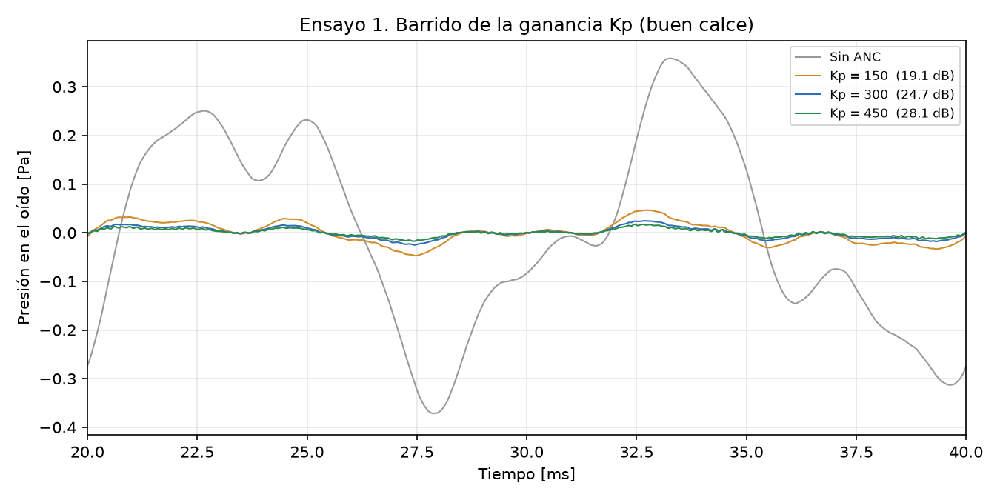
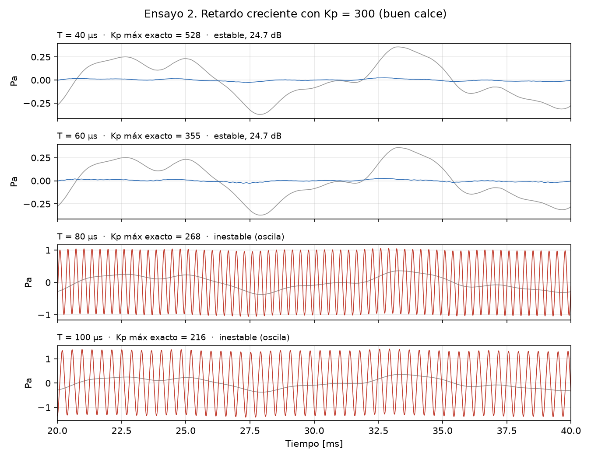
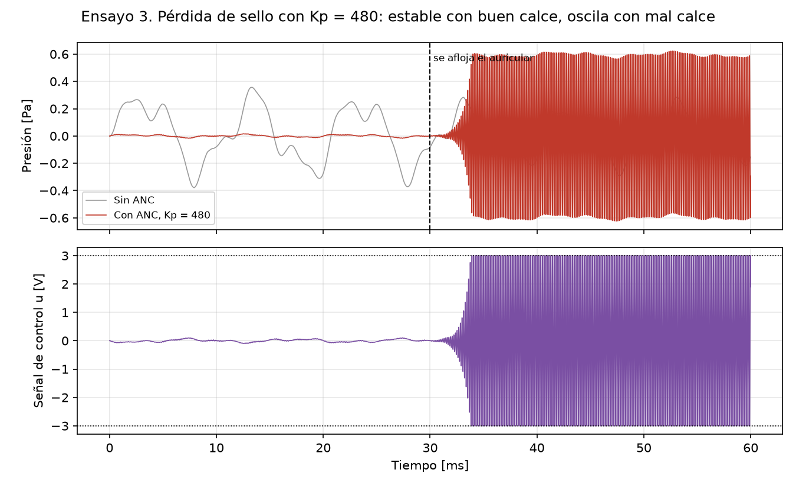
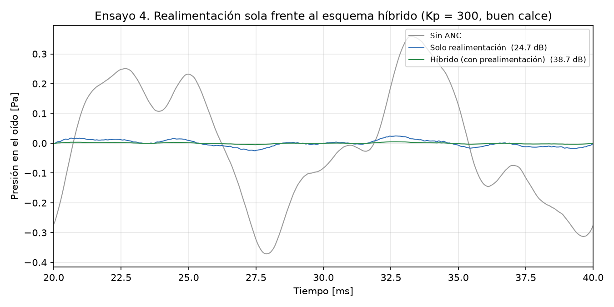
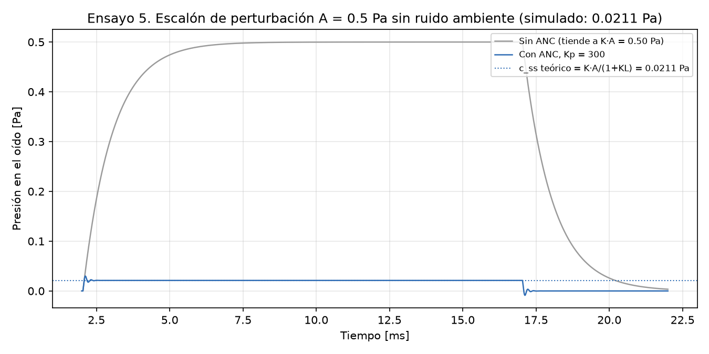
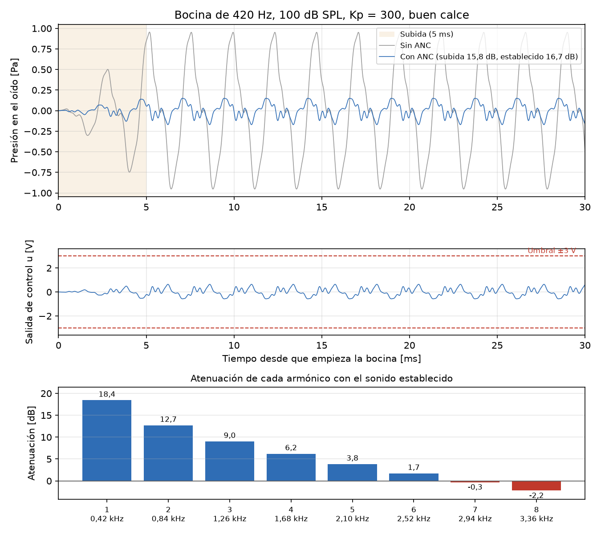

# Evidencia de los ensayos

Un caso por cada ensayo de la sección 9 del informe (casos 01 a 05), más el caso 06, que
prueba la bocina de la sección 8.7. Cada carpeta tiene el gráfico (`figura.png`; en los casos
01 a 05 es el mismo que va en el informe) y un README con qué se prueba, los parámetros,
qué predice el informe, qué dio la simulación y el veredicto.

**Cómo se generó:** `python generar_evidencia.py`, que usa `simulacion_anc.py` sin modificarlo.
La simulación usa una semilla fija, así que volver a generarla da los mismos números.

**Veredicto** (criterio de la sección 6.7): *falla* si el lazo oscila, si el parlante queda
saturado en forma sostenida o si la atenuación en la banda baja (tono de 50 Hz) queda por
debajo de 20 dB; *error admisible* en los demás casos. **¿Coincide con la predicción?** indica
si la simulación da lo que predice el informe, también cuando lo predicho es una falla.

## Resumen

| Caso | Sección del informe | Qué predice el informe | Qué dio la simulación | Veredicto | ¿Coincide con la predicción? |
|---|---|---|---|---|---|
| 1. Barrido de Kp: Kp = 150 | 8.3, 9.2 | Crece con Kp y queda bajo el valor estático (21,8 dB); 9.2 reporta 19,1 dB | 19,1 dB (ruido completo), 21,4 dB en la banda baja | Error admisible. Fuera de la ventana de diseño: con mal calce fallaría. | Sí |
| 1. Barrido de Kp: Kp = 300 | 8.3, 9.2 | Crece con Kp y queda bajo el valor estático (27,5 dB); 9.2 reporta 24,7 dB | 24,7 dB (ruido completo), 27,1 dB en la banda baja | Error admisible | Sí |
| 1. Barrido de Kp: Kp = 450 | 8.3, 9.2 | Crece con Kp y queda bajo el valor estático (30,9 dB); 9.2 reporta 28,1 dB | 28,1 dB (ruido completo), 30,5 dB en la banda baja | Error admisible. Fuera de la ventana de diseño: con mal calce fallaría. | Sí |
| 2. Retardo: T = 40 y 60 µs | 8.4, 9.3 | Kp máx 528 y 355 > 300: estable, 24,7 dB | Estable; 24,7 y 24,7 dB | Error admisible | Sí |
| 2. Retardo: T = 80 y 100 µs | 8.4, 9.3 | Kp máx 268 y 216 < 300: oscila | Oscila; saturado el 41 y 54 % del tiempo | Falla (oscila y satura). Buscada por el ensayo | Sí |
| 3. Pérdida de sello: antes de aflojarse | 8.6, 9.4 | Kp = 480 < 528: estable; 9.4 reporta 28,6 dB | Estable; 28,6 dB | Error admisible | Sí |
| 3. Pérdida de sello: después de aflojarse | 6.7, 8.6, 9.4 | Kp = 480 > 447: oscila (~6,4 kHz) y satura | Oscila a 6,35 kHz; saturado el 37 % del tiempo | Falla (oscila y satura). Buscada por el ensayo | Sí |
| 4. Híbrido: con y sin prealimentación | 9.5 | Mejora de 14,0 dB; 9.5 reporta 24,7 → 38,7 dB | 24,7 → 38,7 dB (+14,0 dB) | Error admisible | Sí |
| 5. Escalón de 0,5 Pa | 6.5, 8.3, 9.6 | c_ss = K·A/(1+KL) = 0,0211 Pa; sobrepico 41,5 %, asentamiento 0,43 ms | c_ss = 0,0211 Pa (4,2 % del escalón); sobrepico 41,5 %, 0,43 ms | Error admisible | Sí |
| 6. Bocina de 420 Hz, 100 dB SPL | 8.7 | Subida 16 a 17,5 dB ≈ establecido 16,7 dB; fundamental 18 dB, 5.º armónico 4 dB, desde el 7.º amplifica; u ≤ 0,9 V | Subida 15,8 a 17,5 dB, establecido 16,7 dB; armónicos 18,4 / 3,8 / -0,3 dB; u máx. 0,87 V | Error admisible | Sí |

Hay 2 situaciones de falla y son buscadas: los ensayos 2 y 3 existen para provocarlas.
En todos los casos la simulación coincide con lo que predice el informe.

## Casos

### [01. Barrido de la ganancia Kp](01_barrido_kp/README.md) (sección 9.2)

### [02. Retardo creciente](02_retardo/README.md) (sección 9.3)

### [03. Pérdida de sello](03_perdida_sello/README.md) (sección 9.4)

### [04. Realimentación sola y esquema híbrido](04_hibrido/README.md) (sección 9.5)

### [05. Error en estado estable ante un escalón](05_escalon/README.md) (sección 9.6)

### [06. Ruido de golpe: bocina](06_bocina/README.md) (sección 8.7)

